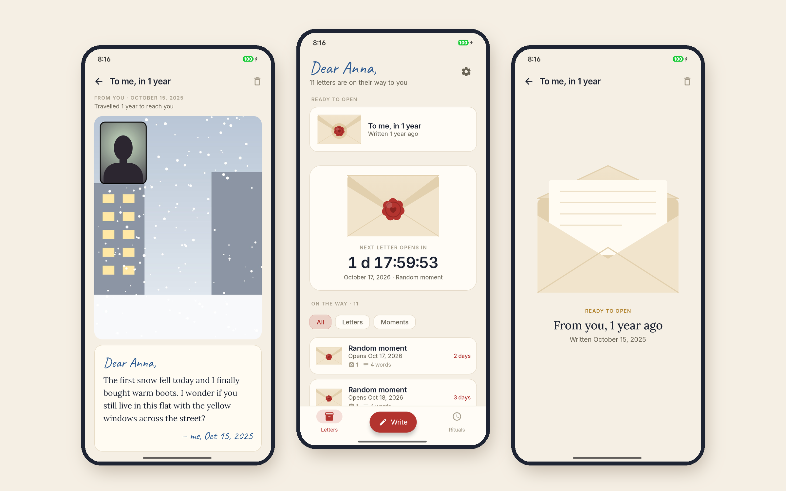
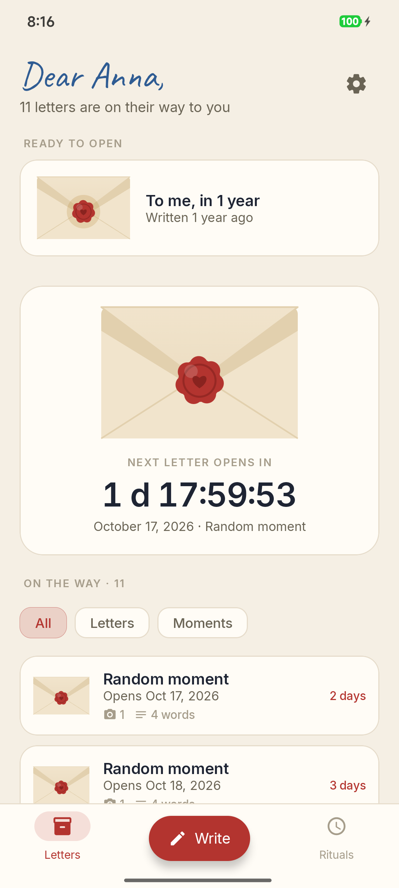
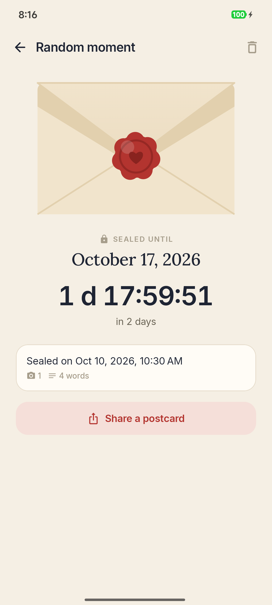
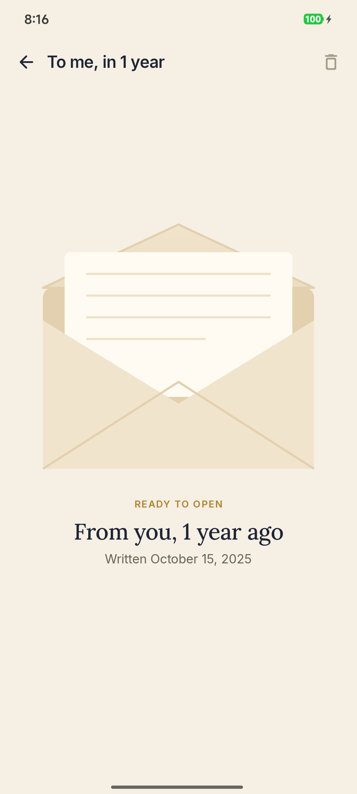
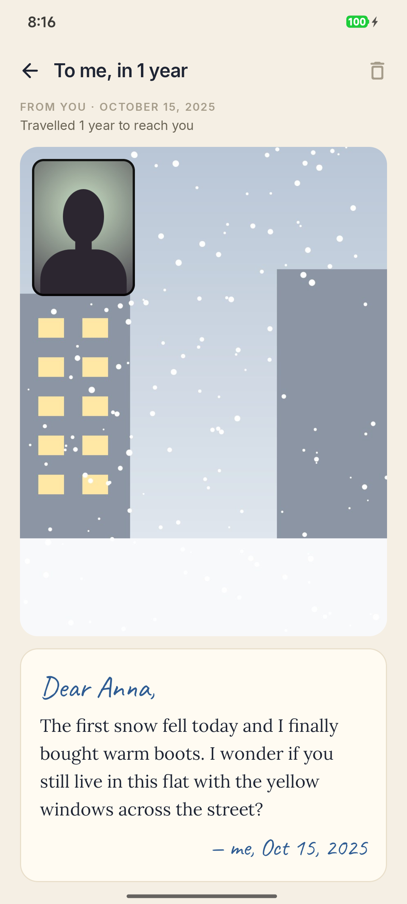
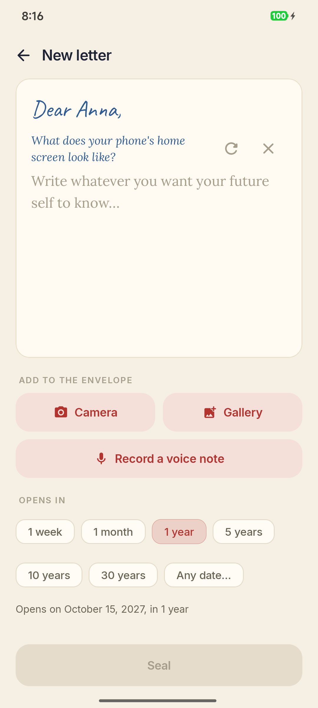
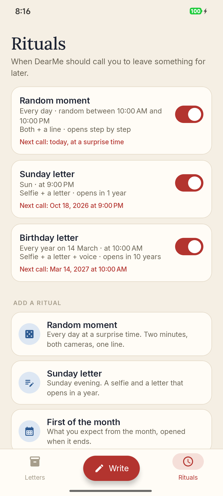

<div align="center">


# DearMe

### Letters to your future self. Sealed until the day comes.

*Write now, read in a year, five or thirty. Photos, your voice, and random moments caught in two minutes, BeReal-style, but only for you. Free, no ads, no account, nothing leaves the phone.*

[](https://github.com/bigdevwhale/dearme/actions/workflows/android.yml)
[](https://github.com/bigdevwhale/dearme/releases/latest)


[](LICENSE)

**English** · [Русский](README.ru.md) · [Website](https://bigdevwhale.github.io/stillcraft/apps/dearme/) · [Changelog](CHANGELOG.md)



</div>

---

## The idea

We remember what happened, but not how it felt: what we were afraid of, what the street looked like, how our voice sounded on an ordinary Tuesday.

DearMe keeps those things in envelopes. You write a letter, add a photo or a minute of your voice, pick a day, and seal it. Until that day it can't be opened, not even by you. And at a random moment each day it calls: *two minutes, what's happening right now?* Both cameras, one line, sealed. A week later, a month later, a year later, the envelopes start coming back.

## What's inside

| | Feature | How it works |
|---|---|---|
| ✉️ | **Letters** | Text, several photos (back camera, selfie, both at once, or from the gallery) and a voice note of up to a minute. Opens in a week, a month, 1, 5, 10 or 30 years, or on any date you pick. |
| 🎲 | **Random moments** | Every day at a surprise time inside your window, DearMe calls. You have two minutes for a dual shot (back camera, then a selfie a second later) and one line. Late answers get a stamp. |
| 🕯️ | **Rituals** | Your own rules for when to be called: a random or exact time, on chosen weekdays, once a month or once a year, with what goes in (photo mode, a line or a letter, voice, a question) and how long it stays sealed. Templates: *Random moment*, *Sunday letter*, *First of the month*, *Birthday letter*. |
| 🪜 | **Step by step** | Moments open after a week while the habit is new, after a month during the first year, after a year from then on, so there is something to open from the second week. |
| 🔴 | **The seal** | A sealed letter shows only its date, a countdown and what's inside (📷 2 · 🎙 0:42 · 340 words). When the day comes, you break the wax and the flap lifts. |
| 🖼️ | **Then & now** | After opening, stand where you stood and take the same shot today; the two go side by side. |
| ↩️ | **Write back** | Reply to your past self, and the answer is sealed for the next stretch: a correspondence with yourself across years. |
| 💌 | **Share cards** | Story-sized pictures: *I sealed a letter to myself, it opens on 14 October 2056*, an opened letter with its photo, then & now. |
| ❓ | **40 questions** | *What are you most afraid of right now? Who do you miss? What will you laugh at when you read this?* For when the page is blank. |
| 🕰️ | **Clock check** | Moving the phone's date forward doesn't open anything: DearMe compares the clock with time since boot and, when online, with the network. |
| 📦 | **One-file backup** | Every letter, photo and voice note in a single `.dearme` file to carry to the next phone. Inside, it's scrambled, so unzipping it doesn't spoil unopened letters. |

<table>
  <tr>
    <td></td>
    <td></td>
    <td></td>
  </tr>
  <tr>
    <td></td>
    <td></td>
    <td></td>
  </tr>
</table>

## English & Русский

Every screen and question is written natively in both languages. Switch in **⚙ → Language**.

## Download

Get the APK from **[Releases](https://github.com/bigdevwhale/dearme/releases/latest)**, or the debug APK attached to any [CI run](https://github.com/bigdevwhale/dearme/actions/workflows/android.yml). DearMe needs Android 8.0 (API 26) or newer.

> [!TIP]
> On Xiaomi (MIUI / HyperOS), Huawei and some other phones, allow **Autostart** for DearMe and remove battery limits, or random moments may not ring.

> [!IMPORTANT]
> Letters live only on your phone. For a letter meant for 2056, save a backup in **⚙ → Backup** now and then and keep the file somewhere safe.

## Privacy

No accounts, no servers, no analytics, no ads. Letters, photos and voice notes stay in the app's private storage. The only network request is a quiet look at the network clock before a seal is broken. A backup file is made only when you ask for one.

## Honest about the lock

There is no server, so the seal is a strong habit, not a vault: the clock check and the scrambled backup make peeking hard and deliberate, not impossible. It's a diary lock for the person you're going to be.

## Under the hood

- **Kotlin + Jetpack Compose**, Material 3 with a paper, ink and wax palette; Lora for letters, Caveat for handwriting, Inter for the rest.
- **CameraX** (`LifecycleCameraController`): dual shots are taken back-then-front a second apart, normalised (rotated, selfies mirrored, ≤1920 px) and stored as JPEG. **Coil** shows them.
- **AlarmManager** with exact alarms when allowed. A random call time is rolled once and kept, so restarts don't re-roll it; calls missed by under ten minutes still ring; the two minutes count from when the call actually rang.
- **Room** keeps capsules, photos, rituals and calls; **DataStore** the settings and the last trusted clock reading. The envelope and seal are drawn on a Canvas, and the share cards with plain `android.graphics`.
- Backups are a zip (records + media) streamed through AES-CTR.

```
app/src/main/java/app/dearme/
├── content/     40 questions (EN + RU)
├── data/        Room, settings, media files, clock check, backup, demo seed
├── domain/      schedule (next call), lock (calendar years, the ladder), time guard
├── notify/      ritual calls and opening alarms
└── ui/          letters, write, moment, capsule (seal + ceremony), rituals, camera, share cards, settings
```

Build it with `./gradlew assembleDebug`. `./gradlew installDebug -Pdemo` installs `app.dearme.demo` with a year of made-up letters and moments (painted stand-ins for photos), the one used for these screenshots. In any build, a ritual's **Try it now** calls you right away.

## License

[MIT](LICENSE). Part of [Stillcraft](https://bigdevwhale.github.io/stillcraft/), small tools for a quieter mind.
