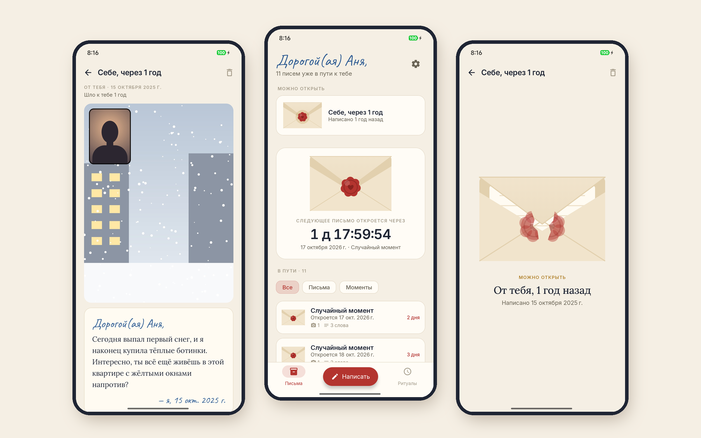
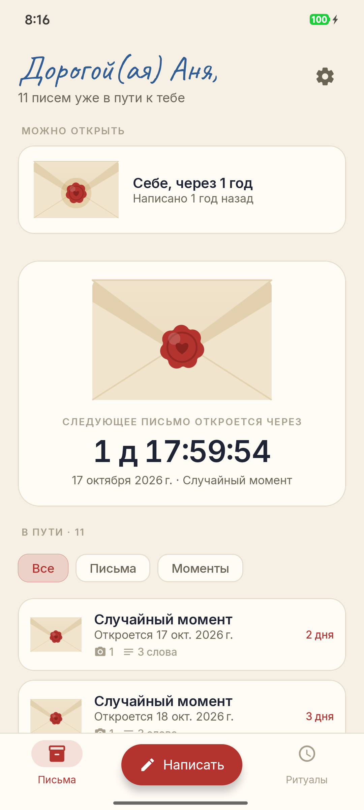
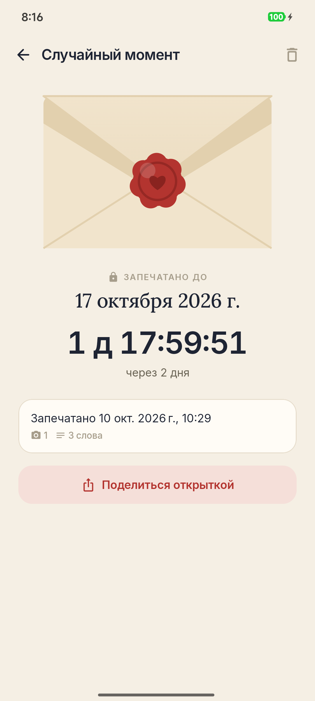
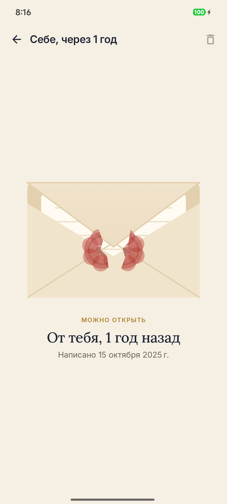
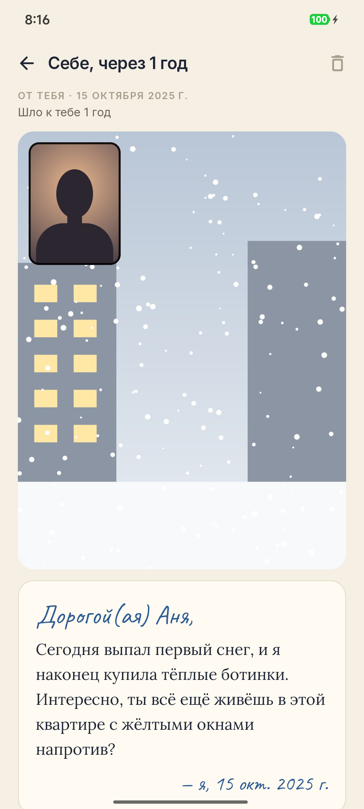
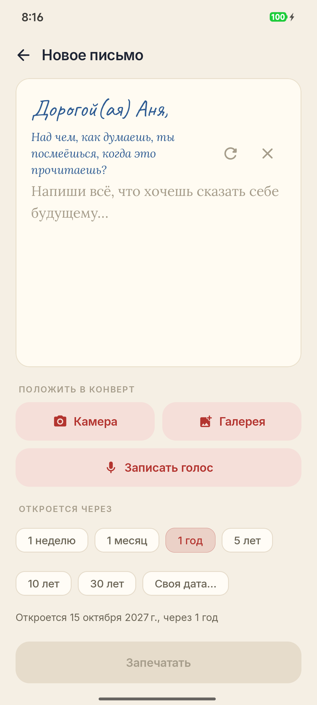
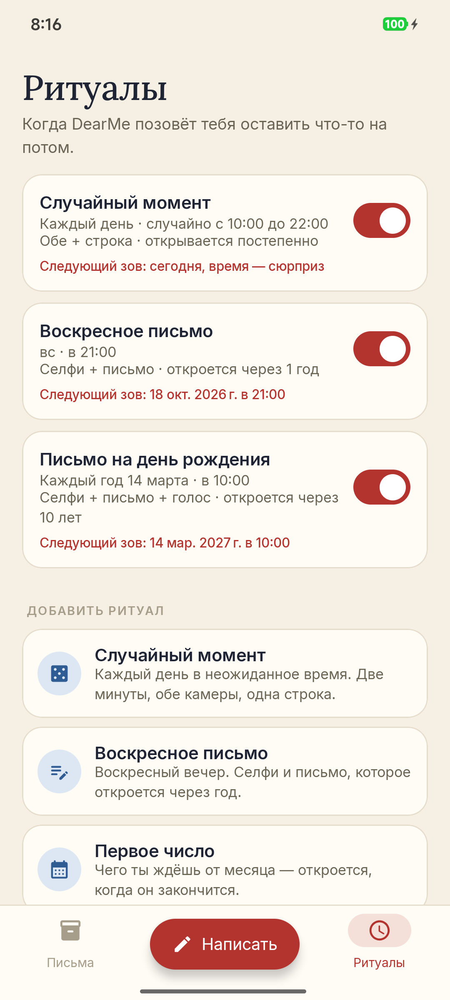

# DearMe

### Письма себе в будущее. Запечатаны до нужного дня.

*Пиши сейчас — читай через год, пять или тридцать лет. Фото, твой голос и случайные моменты, пойманные за две минуты, как в BeReal, только для тебя одного. Бесплатно, без рекламы и аккаунта, ничего не покидает телефон.*

[English](README.md) · **Русский** · [Сайт](https://bigdevwhale.github.io/stillcraft/apps/dearme/) · [Изменения](CHANGELOG.md)

---

## Идея

Мы помним, что происходило, но не помним, каково это было: чего мы боялись, как выглядела улица, как звучал наш голос в самый обычный вторник.

DearMe хранит это в конвертах. Пишешь письмо, добавляешь снимок или минуту голоса, выбираешь день — и запечатываешь. До этого дня письмо не открыть, даже тебе. А в случайный момент каждого дня приложение зовёт: *две минуты — что происходит прямо сейчас?* Обе камеры, одна строка, печать. Через неделю, месяц, год конверты начинают возвращаться.

## Что внутри

| | Что | Как работает |
|---|---|---|
| ✉️ | **Письма** | Текст, несколько снимков (задняя камера, селфи, обе сразу или из галереи) и голос до минуты. Откроется через неделю, месяц, 1, 5, 10 или 30 лет — или в любую выбранную дату. |
| 🎲 | **Случайные моменты** | Каждый день в неожиданное время внутри твоего окна DearMe зовёт. У тебя две минуты на двойной снимок (задняя камера, через секунду селфи) и одну строку. На опоздавших ответах остаётся штамп. |
| 🕯️ | **Ритуалы** | Свои правила, когда звать: случайное или точное время, выбранные дни недели, раз в месяц или раз в год; что внутри (режим фото, строка или письмо, голос, вопрос) и на сколько запечатывать. Шаблоны: *Случайный момент*, *Воскресное письмо*, *Первое число*, *Письмо на день рождения*. |
| 🪜 | **Постепенно** | Пока привычка новая, моменты открываются через неделю, в первый год — через месяц, дальше — через год. Открывать есть что уже со второй недели. |
| 🔴 | **Печать** | У запечатанного письма видны только дата, обратный отсчёт и что внутри (📷 2 · 🎙 0:42 · 340 слов). Когда день приходит, сургуч трескается, и клапан конверта поднимается. |
| 🖼️ | **Тогда и сейчас** | После открытия встань там же, где тогда, и сделай такой же снимок — они встанут рядом. |
| ↩️ | **Ответ себе** | Ответь себе из прошлого, и ответ запечатается на следующий срок — переписка с собой длиной в годы. |
| 💌 | **Открытки** | Картинки для сторис: *Я запечатал(а) письмо себе, оно откроется 14 октября 2056 г.*, открытое письмо со снимком, «тогда и сейчас». |
| ❓ | **40 вопросов** | *Чего ты сейчас боишься больше всего? По кому ты скучаешь? Над чем ты посмеёшься, когда это прочитаешь?* — когда страница пустая. |
| 🕰️ | **Проверка часов** | Перевести дату вперёд не поможет: DearMe сверяет часы со временем с момента загрузки, а при интернете — с сетевым временем. |
| 📦 | **Бэкап одним файлом** | Все письма, снимки и записи в одном файле `.dearme` для переезда на новый телефон. Внутри он зашифрован, так что распаковка не испортит сюрприз. |

<table>
  <tr>
    <td></td>
    <td></td>
    <td></td>
  </tr>
  <tr>
    <td></td>
    <td></td>
    <td></td>
  </tr>
</table>

## English и русский

Все экраны и вопросы написаны на обоих языках с нуля. Переключение: **⚙ → Язык**.

## Скачать

APK — в **[Releases](https://github.com/bigdevwhale/dearme/releases/latest)** или отладочный APK в любом [запуске CI](https://github.com/bigdevwhale/dearme/actions/workflows/android.yml). Нужен Android 8.0 (API 26) или новее.

> [!TIP]
> На Xiaomi (MIUI / HyperOS), Huawei и некоторых других телефонах разреши DearMe **автозапуск** и сними ограничения батареи, иначе случайные моменты могут не приходить.

> [!IMPORTANT]
> Письма хранятся только на телефоне. Если письмо адресовано 2056 году, время от времени сохраняй бэкап в **⚙ → Бэкап** и держи файл в надёжном месте.

## Приватность

Без аккаунтов, серверов, аналитики и рекламы. Письма, снимки и записи лежат в закрытом хранилище приложения. Единственный сетевой запрос — тихая сверка с сетевыми часами перед тем, как сломать печать. Файл бэкапа создаётся только по твоей просьбе.

## Честно о замке

Сервера нет, поэтому печать — это крепкая привычка, а не сейф: проверка часов и зашифрованный бэкап делают подглядывание трудным и осознанным, но не невозможным. Это замочек на дневнике для того, кем ты станешь.

## Как устроено

- **Kotlin + Jetpack Compose**, Material 3 в палитре бумаги, чернил и сургуча; Lora для писем, Caveat для «почерка», Inter для остального.
- **CameraX** (`LifecycleCameraController`): двойной снимок делается задней камерой, а через секунду фронтальной, затем нормализуется (поворот, зеркальное селфи, до 1920 px) и хранится в JPEG. Показывает их **Coil**.
- **AlarmManager** с точными будильниками, если они разрешены. Случайное время выбирается один раз и сохраняется, поэтому перезапуск его не меняет; зов, пропущенный меньше чем на десять минут, всё равно прозвучит; две минуты отсчитываются от реального звонка.
- **Room** хранит капсулы, снимки, ритуалы и вызовы; **DataStore** — настройки и последнее надёжное показание часов. Конверт и печать нарисованы на Canvas, открытки — обычным `android.graphics`.
- Бэкап — zip (записи + медиа), пропущенный через AES-CTR.

Сборка: `./gradlew assembleDebug`. `./gradlew installDebug -Pdemo` ставит `app.dearme.demo` с годом выдуманных писем и моментов (вместо фото — рисованные сцены); с неё сделаны скриншоты. В любой сборке кнопка ритуала **«Попробовать сейчас»** зовёт сразу.

## Лицензия

[MIT](LICENSE). Часть [Stillcraft](https://bigdevwhale.github.io/stillcraft/) — небольших инструментов для спокойного ума.
